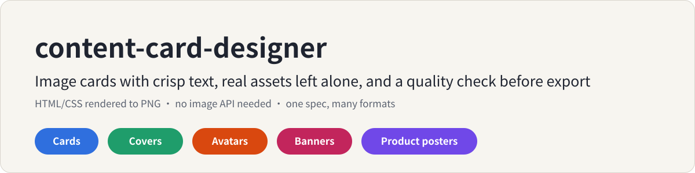
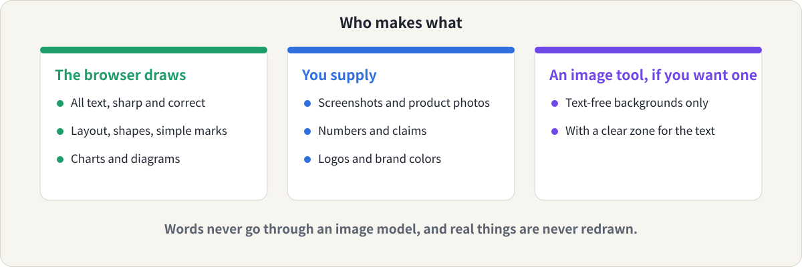
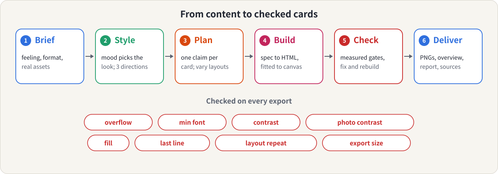

<p align="center">
  
</p>

<p align="center">
  <b>English</b> &nbsp;|&nbsp; <a href="README.zh-CN.md">简体中文</a>
  &nbsp;|&nbsp; <a href="LICENSE">MIT License</a>
</p>

A [Claude](https://claude.ai) skill for people who **turn text into image cards** (Xiaohongshu, Instagram, LinkedIn, WeChat covers, blog covers) and are tired of garbled text, cards that overflow, and every set looking the same.

You give Claude your content and where it will be posted. It gives you PNGs that are laid out by a browser, fitted to the canvas, and checked before you see them.

## Is this for you?

- You make carousels or image posts and want them **consistent across a whole set**, not one-offs.
- Image models garble your text, especially Chinese, and you are done retyping it in an editor.
- You post in **more than one format** (3:4, 4:5, 1:1, 16:9, a cover, an avatar) and want one source for all of them.
- You have **real material** (screenshots, product photos, numbers) that must not be redrawn or "improved".
- You don't want to set up an image API, or to hand an agent your social accounts.

## What you get

1. **PNG cards** at the exact size of the format, from a single JSON spec.
2. **A quality report** per export: overflow, minimum font size, contrast (including text over photos), fill, short last lines, repeated layouts, export size.
3. **An overview image** of the whole set, and **style directions** (the same card in three or four moods) when the look isn't settled.
4. **HTML sources** you can edit by hand.

It covers 13 layouts: cover, list, steps, points, numbered point, compare, stat, quote, call to action, text over a picture, product, avatar and profile banner, across eight formats.

What it won't do: draw photographs or illustrations, make print-ready logos, post for you, or invent text, numbers or product claims.

## The idea in 30 seconds

Text is code-rendered, real things stay real, and an image tool is optional.

<p align="center">
  
</p>

Then every export goes through the same loop.

<p align="center">
  
</p>

A card is a layout in a spec. The builder fits it to the canvas by scaling it up or down, so the same content works across formats without cropping. A card that still can't fit at the minimum font size **fails** and has to be cut or split; the tool never shrinks text below readable.

## See it work

A five-card Xiaohongshu set from the README of [content-topic-decomposer](https://github.com/meiluosi/content-topic-decomposer). All five pass the checks.

<p align="center">
  
</p>

The same cover in four moods, so you can choose a direction instead of describing taste:

<p align="center">
  
</p>

A product poster. The mug image is placed as supplied (its empty transparent margins are trimmed; the visible pixels are not touched), and the text is only what the user gave:

<p align="center">
  
</p>

One title across a 16:9 cover, a square cover and an avatar:

<p align="center">
  
  
  
</p>

Every example folder has its spec, the PNGs and the quality report. `examples/build_examples.sh` rebuilds them.

## Where it differs from other card skills

Several good projects exist, and this one borrows ideas from them (see Credit). Based on reading their READMEs and issues, not on running them:

- **No image-model route for text.** Tools that draw cards with an image model run into garbled Chinese ([for example](https://github.com/JimLiu/baoyu-skills/issues/73)). Here text is always browser-rendered.
- **Quality gates you can read.** Each export gets a report of what was measured, including what was *not* verified.
- **Formats are data.** One editable `formats.json` drives sizes, margins, minimum fonts and card budgets, and each canvas is re-composed rather than cropped.
- **It keeps your words.** Wording and claims stay as written; suspected typos are flagged, not silently rewritten, and extra supporting text is offered, not inserted.
- **No build chain, no API key, no account access.** It needs Python 3 and a Chromium-family browser. If only `SKILL.md` gets installed, the skill still has what it needs to work by hand.

Where it is weaker: it is newer and much smaller; it has fewer ready-made visual styles; and it can't make illustrations or photos.

## Install

**Claude Code** (personal skill):

```bash
git clone https://github.com/meiluosi/content-card-designer.git
cp -r content-card-designer/skills/content-card-designer ~/.claude/skills/
```

**Claude.ai / Claude desktop:** zip the `skills/content-card-designer` folder (so that `SKILL.md` sits inside it) and upload it under Settings → Capabilities → Skills.

**Requirements:** Python 3, and Chrome, Edge, Chromium or Brave. [Pillow](https://pypi.org/project/pillow/) is optional; without it, text over photos is reported as not verified and product images are not trimmed. Check with:

```bash
python3 skills/content-card-designer/scripts/cardkit.py check-env
```

## Use

Describe what you want to make and where it will go. For example:

- "Turn these four tips into a five-card Xiaohongshu set. Calm and professional."
- "把这段内容做成小红书图文，5 张左右。"
- "Make a cover for my article in 16:9 and square, plus an avatar with the letter M. Warm and friendly."
- "Here's my product photo. Make an Instagram 4:5 poster, warm look."
- "Show me three style directions for this cover before we start."

Claude picks the skill from what you ask. If it doesn't trigger, name it: in Claude Code type `/content-card-designer`, or say "use the content-card-designer skill" in Claude.ai.

It pairs with the other two skills in this series: [content-topic-decomposer](https://github.com/meiluosi/content-topic-decomposer) plans what to post, [human-in-the-loop-writing](https://github.com/meiluosi/human-in-the-loop-writing) helps you write it, and this one turns it into cards.

Using the script directly:

```bash
python3 skills/content-card-designer/scripts/cardkit.py build spec.json --out out
python3 skills/content-card-designer/scripts/cardkit.py directions spec.json --moods warm,efficient,knowledge
```

## How well does it work?

Honest answer: small tests, and the results are mixed.

Three tasks (a five-card Chinese set, a cover in three formats, a product poster) were run three ways: plain Claude with no skill, the first version of the skill, and the version after changes made in response to that first round. On a checklist of 17 items about fidelity and checking (only the user's text, wording kept, no clipped text, product unchanged, states what was not verified, and so on), plain Claude passed 10, the first version 13 and the revised version 17.

Treat the 17 of 17 with caution: the checklist was written after seeing the first round, and the revision was made to fix what it found, so it is not an independent test.

What the checklist doesn't measure matters just as much:

- **Plain Claude's cards often looked better.** It added more visual structure (large step numbers, comparison panels, sample code, glows, colorful shapes). It also added text the user hadn't given: explanatory paragraphs, a code sample, an extra English tagline.
- **The skill's first version was faithful but plain**, with sparse cards and a small product image. The revision added numbered-point cards, soft glows, serif titles for warm looks, a product layout that trims empty margins, and an optional circle decoration. Cards are still sparser than plain Claude's richer versions, and the skill offers to draft supporting text instead of adding it.
- **The checks cover defects, not taste.** Passing means "no known problems", not "good design".
- **Photo contrast was tested only on synthetic images.**
- **Renders were slow** because the test machine was busy; that is not a property of the tool.
- **The trigger rate was not measured**, because the command-line trigger test couldn't be run.

Issues and examples from your own content are very welcome.

## What's inside

```
skills/content-card-designer/
├── SKILL.md                         # principles, workflow, fallback without scripts
├── references/
│   ├── workflow.md                  # brief, style directions, planning, delivery
│   ├── spec.md                      # every layout and field, the brand kit
│   ├── layouts.md                   # which layout for which content
│   ├── mood-to-style.md             # from the feeling of the content to the look
│   ├── quality-gates.md             # what is measured, thresholds, fixes
│   ├── backgrounds-and-real-assets.md
│   └── profile-visuals.md           # avatars, banners, style boards
├── assets/                          # formats.json, moods.json, brand-kit template
└── scripts/
    ├── cardkit.py                   # build, directions, lint, formats, check-env
    ├── styles.css, inpage.js        # layouts and the in-browser fitting and checks
    └── test_cardkit.py              # python3 -m unittest (browser test skipped if none)
examples/                            # specs, PNGs and reports; build_examples.sh rebuilds them
assets/                              # diagrams used in this README
```

## Credit

- The idea of working from the emotional tone of the content to a visual style comes from the book 《把自己变成一门生意》. This repository is an independent implementation and contains no text from the book.
- Ideas from [baoyu-skills](https://github.com/JimLiu/baoyu-skills) (MIT) and [xhs-visual-director-skill](https://github.com/ziguishian/xhs-visual-director-skill) (MIT): analyze the content before choosing a layout, confirm before generating, show style options first, keep preferences, check readability on a phone.
- [guizang-social-card-skill](https://github.com/op7418/guizang-social-card-skill) (AGPL-3.0) was read for ideas only (layout recipes, density rules, graded overflow fixes). No code, templates or assets were copied.

## License

[MIT](LICENSE)
