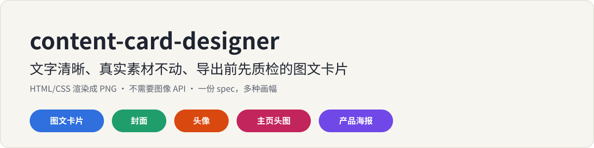
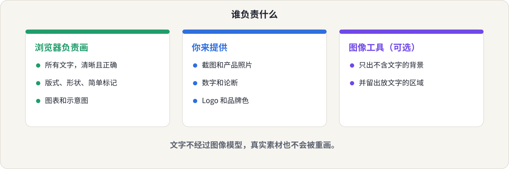
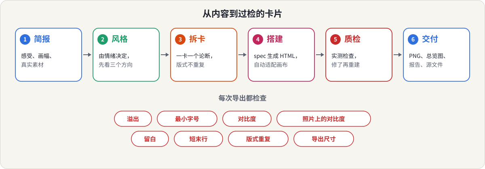
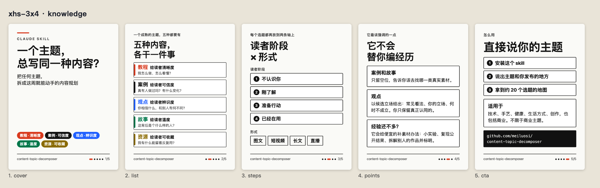
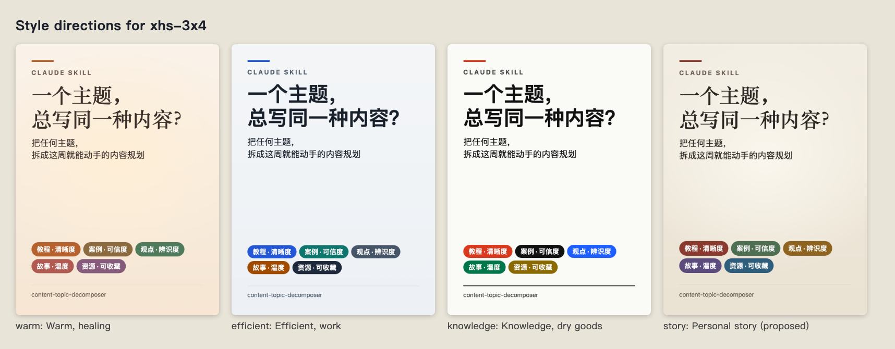
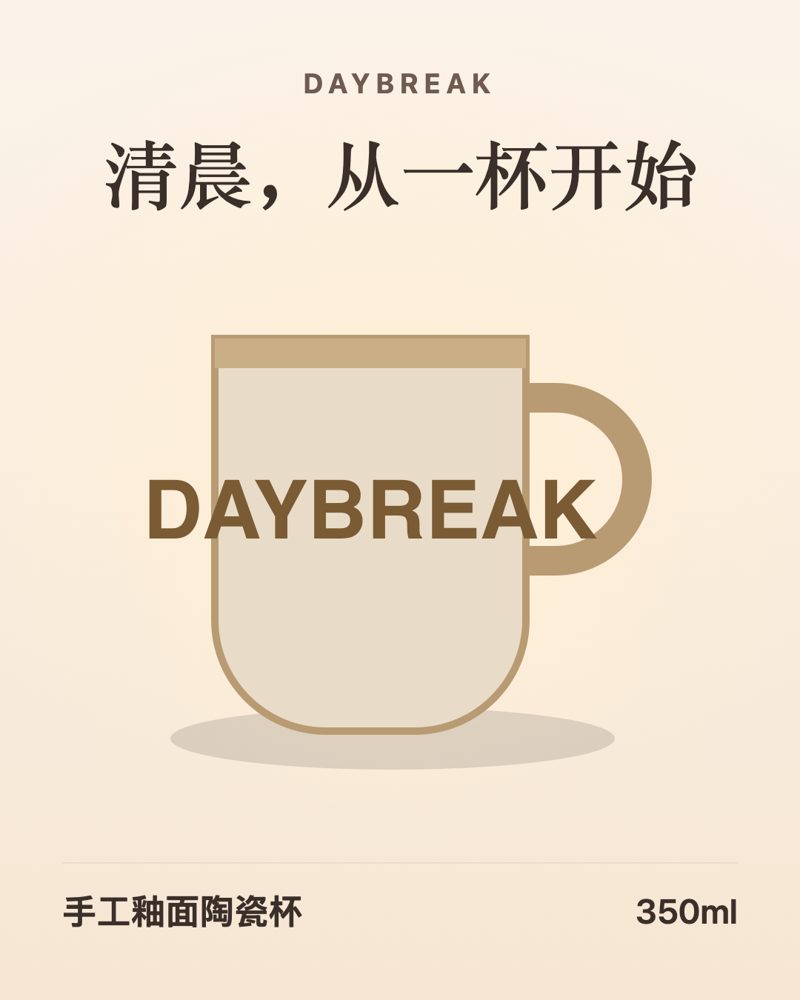
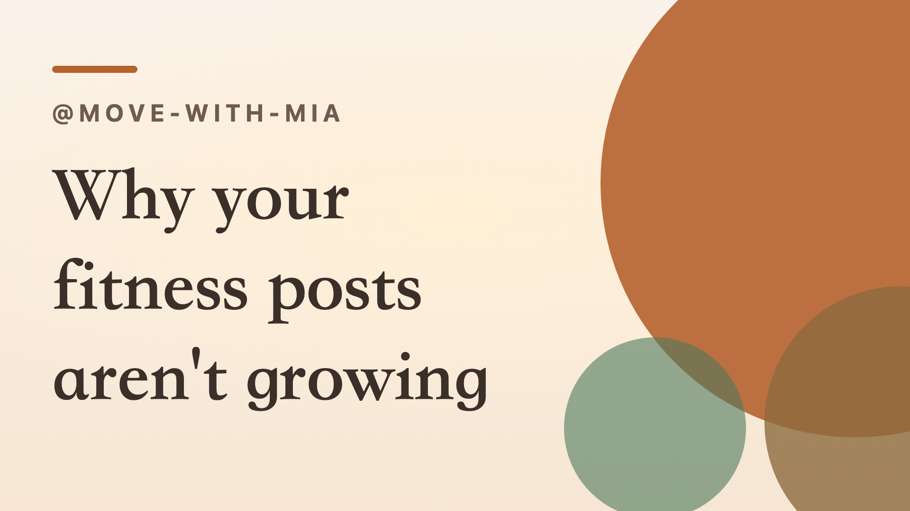
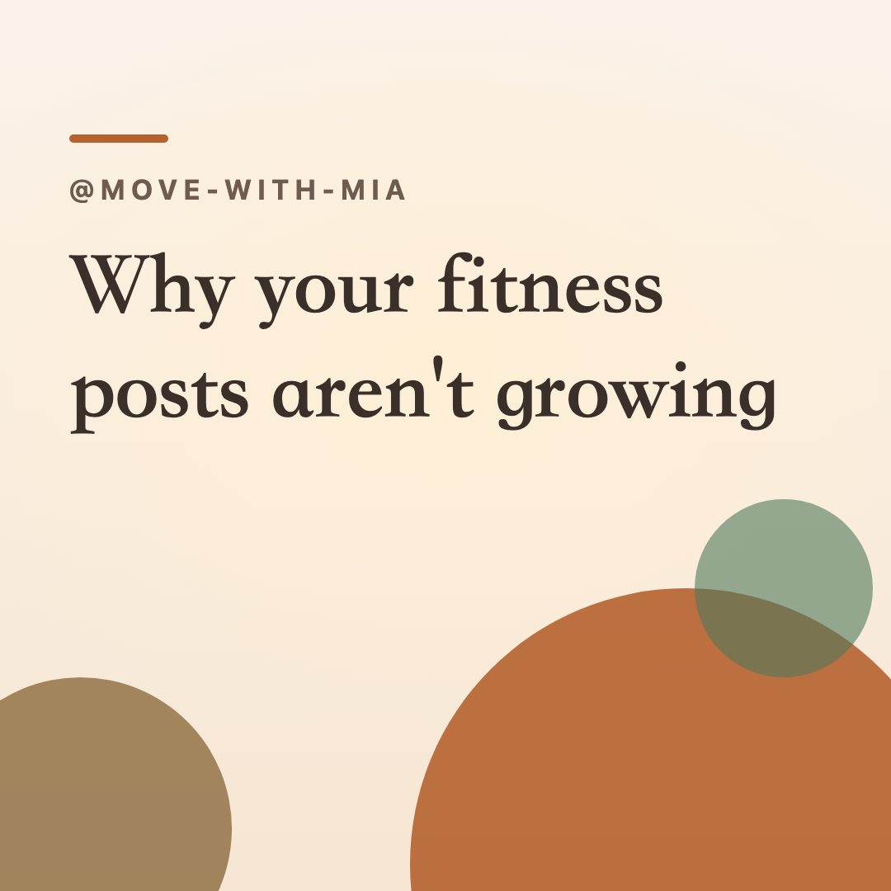

<p align="center">
  
</p>

<p align="center">
  <a href="README.md">English</a> &nbsp;|&nbsp; <b>简体中文</b>
  &nbsp;|&nbsp; <a href="LICENSE">MIT 许可</a>
</p>

一个 [Claude](https://claude.ai) skill，写给**把文字做成图文卡片**的人（小红书、Instagram、LinkedIn、公众号封面、博客封面），也写给受够了文字乱码、卡片溢出、一套图千篇一律的人。

你把内容和发布的地方告诉 Claude，它还你一组 PNG：由浏览器排版、自动适配画布，并且在交给你之前先过一遍检查。

## 这是写给你的吗？

- 你做轮播图或图文帖，希望**一整套风格统一**，而不是单张拼凑。
- 图像模型把你的文字（尤其是中文）画成乱码，你不想再一张张手动改字。
- 你要发**多种画幅**（3:4、4:5、1:1、16:9、封面、头像），想用同一份内容出所有版本。
- 你有**真实素材**（截图、产品图、数字），不能被重画或"优化"。
- 你不想配图像 API，也不想把社交账号交给 AI 代理。

## 你会得到什么

1. **PNG 卡片**：尺寸精确对应所选画幅，由一份 JSON 规格生成。
2. **质量报告**：每次导出都有，包含溢出、最小字号、对比度（含照片上的文字）、留白、短末行、版式重复、导出尺寸。
3. **整套总览图**；风格还没定时，还有**风格方向**（同一张卡用三四种情绪各渲染一遍）。
4. **HTML 源文件**，可以手动再改。

共 13 种版式：封面、列表、步骤、要点、编号要点、对比、数据、引语、结尾、图上文字、产品、头像、主页头图，支持 8 种画幅。

它不会做的事：画照片或插画、做可印刷的标志、替你发布，或者编造文字、数字和产品卖点。

## 30 秒讲清思路

文字由代码排版，真实素材保持原样，图像工具是可选项。

<p align="center">
  
</p>

然后每次导出都走同一个流程。

<p align="center">
  
</p>

一张卡就是规格里的一个版式。构建器通过放大或缩小来适配画布，所以同一份内容能跨画幅使用而不用裁剪。放到最小字号仍然装不下的卡会**失败**，必须删减或拆分；工具不会把文字缩到读不清的程度。

## 看它怎么工作

用 [content-topic-decomposer](https://github.com/meiluosi/content-topic-decomposer) 的 README 做的五张小红书卡片，五张全部通过检查。

<p align="center">
  
</p>

同一张封面用四种情绪渲染，让你选方向，而不是用语言描述口味：

<p align="center">
  
</p>

产品海报。杯子图原样放入（只去掉了四周完全透明的空边，可见像素没动），文字只用了用户给的：

<p align="center">
  
</p>

同一个标题做成 16:9 封面、方形封面和头像：

<p align="center">
  
  
  
</p>

每个示例目录都有规格、PNG 和质量报告。`examples/build_examples.sh` 可以全部重建。

## 和其他图文 skill 的区别

已经有一些很好的项目，这个项目也借鉴了它们的想法（见致谢）。以下是读了它们的 README 和 issue 的印象，**没有实际运行过**：

- **文字不走图像模型。** 用图像模型画卡片的工具会遇到中文乱码（[例如](https://github.com/JimLiu/baoyu-skills/issues/73)）。这里文字永远由浏览器排版。
- **看得见的质量检查。** 每次导出都有报告，写明测了什么，也写明**没测**什么。
- **画幅是数据。** 一份可编辑的 `formats.json` 驱动尺寸、边距、最小字号和卡片数量建议，每种画幅重新排版而不是裁剪。
- **保留你的原话。** 措辞和论断照原样，疑似笔误只提示不静默改写，补充说明是"提议"而不是"插入"。
- **无需构建链、无需 API 密钥、不碰账号。** 只要 Python 3 和一个 Chromium 系浏览器。即使只装了 `SKILL.md`，里面也有手动完成所需的全部要点。

它较弱的地方：更新、规模小得多；现成的视觉风格更少；也画不了插画和照片。

## 安装

**Claude Code**（个人 skill）：

```bash
git clone https://github.com/meiluosi/content-card-designer.git
cp -r content-card-designer/skills/content-card-designer ~/.claude/skills/
```

**Claude.ai / Claude 桌面端**：把 `skills/content-card-designer` 文件夹打成 zip（`SKILL.md` 在文件夹里面），在 设置 → 能力 → Skills 中上传。

**环境要求**：Python 3，以及 Chrome、Edge、Chromium 或 Brave 之一。[Pillow](https://pypi.org/project/pillow/) 可选；没有它时，照片上的文字会标为"未验证"，产品图也不会去空边。检查环境：

```bash
python3 skills/content-card-designer/scripts/cardkit.py check-env
```

## 使用

说出你想做什么、发到哪里。例如：

- "把这段内容做成小红书图文，5 张左右，克制专业一点。"
- "Turn these four tips into a five-card Xiaohongshu set. Calm and professional."
- "给我的文章做一个 16:9 和方形封面，再做个字母 M 的头像，暖一点、亲切一点。"
- "这是我的产品图，帮我做一张 Instagram 4:5 的产品海报，暖色。"
- "开始之前，先给我看这张封面的三种风格方向。"

Claude 会根据你的需求自动调用。没有自动触发时可以点名：在 Claude Code 里输入 `/content-card-designer`，在 Claude.ai 里说"用 content-card-designer 这个 skill"。

它和系列里另外两个 skill 搭配使用：[content-topic-decomposer](https://github.com/meiluosi/content-topic-decomposer) 规划发什么，[human-in-the-loop-writing](https://github.com/meiluosi/human-in-the-loop-writing) 帮你写出来，这个把它做成卡片。

直接用脚本：

```bash
python3 skills/content-card-designer/scripts/cardkit.py build spec.json --out out
python3 skills/content-card-designer/scripts/cardkit.py directions spec.json --moods warm,efficient,knowledge
```

## 效果如何？

诚实地说：只做过小规模测试，结果有好有坏。

三个任务（一套中文五张图、一个三种画幅的封面、一张产品海报），各用三种方式跑：不带 skill 的 Claude、skill 第一版、以及根据第一轮结果修改后的版本。用一份 17 项的清单评分，关于忠实度和检查（只用用户的文字、保持原话、没有被裁切的文字、产品图不变、说明哪些没验证，等等），不带 skill 的通过 10 项，第一版 13 项，修改后 17 项。

对"17 满分"要谨慎看待：清单是看过第一轮结果后才写的，修改也是为了解决它发现的问题，所以这不是独立测试。

清单没有衡量的内容同样重要：

- **不带 skill 的 Claude，画面常常更好看。** 它加了更多视觉结构（大号步骤数字、对比面板、示意代码、光晕、彩色形状），同时也加了用户没给的文字：解释段落、示意代码、一行多余的英文标语。
- **skill 第一版忠实但朴素**：卡片偏空，产品图偏小。修改后加了编号要点卡、柔和光晕、暖色衬线标题、会去掉空边的产品版式，以及可选的圆形装饰。卡片仍然比不带 skill 时更疏朗，skill 选择"提议补充说明"而不是直接加上。
- **检查针对缺陷，不针对品味。** 通过只代表"没有已知问题"，不代表"设计好看"。
- **照片对比度只在合成图上测过。**
- **渲染很慢**，是因为测试机当时很忙，不是工具本身的特点。
- **没有测触发率**，因为命令行触发测试跑不起来。

欢迎提 issue，也欢迎贡献你自己内容的示例。

## 目录

```
skills/content-card-designer/
├── SKILL.md                         # 原则、工作流、没有脚本时的手动方案
├── references/
│   ├── workflow.md                  # 简报、风格方向、拆卡、交付
│   ├── spec.md                      # 每种版式和字段、品牌配置
│   ├── layouts.md                   # 什么内容用什么版式
│   ├── mood-to-style.md             # 从内容的情绪到画面风格
│   ├── quality-gates.md             # 测什么、阈值、怎么修
│   ├── backgrounds-and-real-assets.md
│   └── profile-visuals.md           # 头像、主页头图、风格板
├── assets/                          # formats.json、moods.json、品牌配置模板
└── scripts/
    ├── cardkit.py                   # build、directions、lint、formats、check-env
    ├── styles.css、inpage.js        # 版式，以及浏览器内的适配和检查
    └── test_cardkit.py              # python3 -m unittest（没有浏览器时跳过浏览器测试）
examples/                            # 规格、PNG 和报告；build_examples.sh 可以重建
assets/                              # README 里用到的示意图
```

## 致谢

- "从内容的情绪出发反推画面风格"的思路来自《把自己变成一门生意》一书。本仓库为独立实现，不包含该书原文。
- 借鉴了 [baoyu-skills](https://github.com/JimLiu/baoyu-skills)（MIT）和 [xhs-visual-director-skill](https://github.com/ziguishian/xhs-visual-director-skill)（MIT）的想法：先分析内容再选版式、生成前先确认、先看风格选项、保存偏好、检查手机上是否读得清。
- [guizang-social-card-skill](https://github.com/op7418/guizang-social-card-skill)（AGPL-3.0）只读了其思路（版式配方、密度规则、按像素分级的溢出修复），没有复制任何代码、模板或素材。

## 许可

[MIT](LICENSE)
